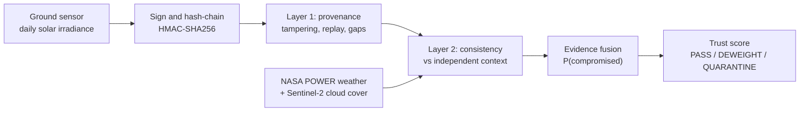
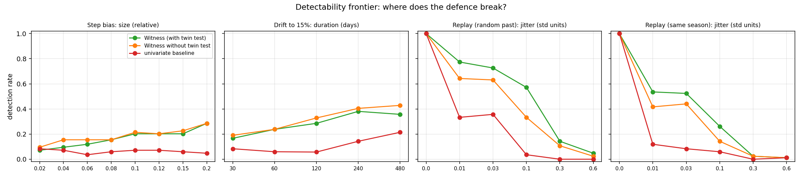
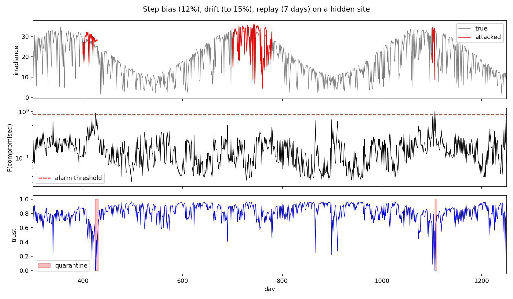

# Witness

**A sensor stream that carries its own proof and its own trust score.**

TSYP14 · *Ground Truth Under Attack* · Track 2: False Data Injection

Automated decisions in agriculture, insurance and water management trust environmental sensor streams. One silently corrupted stream can trigger a wrong decision. Witness answers two questions about every reading: **who produced it?** and **is it consistent with the world around it?**

> A valid signature proves origin, not truth. A compromised sensor signs its lies correctly. Each layer of Witness covers the other's blind spot.

## How it works



| Layer | Catches | Cannot catch |
|---|---|---|
| **1. Provenance**: HMAC-signed, hash-chained records | an outsider who modifies or replays records (100% in our test) | a compromised sensor that holds the key (0%) |
| **2. Consistency**: physics model of the expected reading, plus temporal evidence | step bias, gradual drift, replay, and even a sensor that signs its own lies | an attacker who also corrupts the independent context |

Layer 2 in detail:

1. A gradient-boosted model predicts the clear-sky index from weather context expressed as anomalies against its own recent past, so it transfers to unseen sites.
2. A second model estimates how wrong the first usually is under today's conditions, so a 12% bias on a clear day counts as strong evidence and on a stormy day as weak evidence.
3. CUSUM (step bias), an exponentially weighted average (slow drift) and rolling windows accumulate the evidence over time.
4. A near-duplicate window rule and a **twin test** catch replay. A natural look-alike window also has look-alike weather. A replay does not.
5. A monotone gradient-boosted classifier fuses the evidence into `P(compromised)`, which maps to a trust score and to the actions PASS, DEWEIGHT and QUARANTINE (with hysteresis).

## Results on real data

NASA POWER, 20 sites. Detection rate at about 2 false alarms per 1000 clean days, averaged over 5 different sets of 7 hidden test sites (`run_crosssite.py`):

| Detector | Step bias | Drift | 7-day replay | Held-out: stuck sensor | Held-out: oscillating bias |
|---|---|---|---|---|---|
| **Witness** | **53%** | **49%** | **57%** | **32%** | **29%** |
| Univariate baseline | 6% | 9% | 21% | 6% | 10% |

- The two held-out attacks were never used in training.
- Adding Sentinel-2 cloud cover (`--s2`) raised the standard-attack rates to 56%, 54% and 61% (one run, a modest gain).
- Exact replays are always caught. Median delay is about 8 days for a step bias and about 40 days for drift.
- Cost: signing about 7 µs and verifying about 10 µs per record (177 bytes); the detector runs at about 0.2 ms per day in under 0.5 MB.

### Where it works and where it breaks

Detection depends strongly on climate. Weather context predicts irradiance well only where clouds are predictable.

- **70-80%** in clear-sky-dominated climates (Mediterranean, arid, dry-season monsoon)
- **20-30%** where clouds dominate (maritime, high latitude)
- **about 4%** in an equatorial convective climate

The detectability frontier sweeps the attacker's choices instead of reporting one accuracy number. It shows the clearest evasion: replay with added noise of about a third of the series' standard deviation looks like natural weather variability, and detection falls below 20%.





## Evaluation protocol

- Sites are split five ways with no overlap: physics model, noise model, fusion model, alarm threshold, hidden test sites.
- Attack positions are random, because the final test hides site and interval.
- Detectors are compared at a matched false-alarm rate, and the deployed threshold is reported too.
- Results depend on which sites are hidden, so the headline numbers are averages over 5 rotations. The range is reported.
- The baseline uses the same machinery but takes its expectation from the series' own recent history.

## Run it

```bash
cd witness_repo
pip install -r requirements.txt
python -m pytest -q                              # 7 tests
python run_crosssite.py --source power           # headline table (about 5 min, downloads NASA POWER data)
python run_experiments.py --source power         # full report: frontier, layers, overheads (about 8 min)
python run_persite.py --source power             # which climates are easy or hard
python run_crosssite.py --source power --s2      # add Sentinel-2 cloud-cover context
python run_experiments.py                        # same pipeline on synthetic data (development)
```

## Repository map

| Path | Contents |
|---|---|
| `witness/provenance.py` | layer 1: signing, hash chain, verifier |
| `witness/detector.py` | layer 2: physics model, evidence, fusion, trust score |
| `witness/attacks.py` | attack simulator: step, drift, replay, stuck sensor, oscillation |
| `witness/evaluate.py` | protocol: scenarios, frontier sweeps, layer matrix, overheads |
| `witness/data.py`, `sentinel2.py` | NASA POWER loader, synthetic generator, Sentinel-2 context |
| `docs/threat_model.md` | assets, attacker levels, assumptions |
| `tests/` | unit tests for every layer |
| `results/` | tables and figures produced by the scripts |

(All paths are inside `witness_repo/`.)

## Assumptions and limits

- The attacked variable is all-sky solar irradiance, and the 12% bias and 15% drift are applied multiplicatively to the recorded value.
- Context sources are independent of the sensor and not corrupted at the same time. Key management is out of scope.
- `P(compromised)` is a score trained on a simulated attack prior, not a calibrated probability for deployment. The alarm threshold targets a false-alarm rate instead.
- Sentinel-2 enters as scene-level cloud cover from the last satellite pass (plus its age in days), not as pixel-level imagery.
- Very small, very slow biases are physically indistinguishable from natural variability. The frontier shows where that boundary lies.
- Early development used a synthetic generator; every number above is on real data.

## Reproducibility

Fixed seeds, documented site splits, one command per result, and tests for the provenance layer, the attack simulator, the replay feature and the Sentinel-2 alignment. Absolute rates vary by about 2 points between machines.
